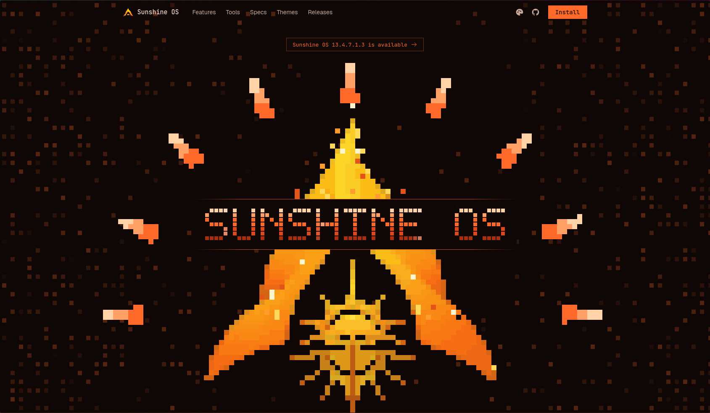
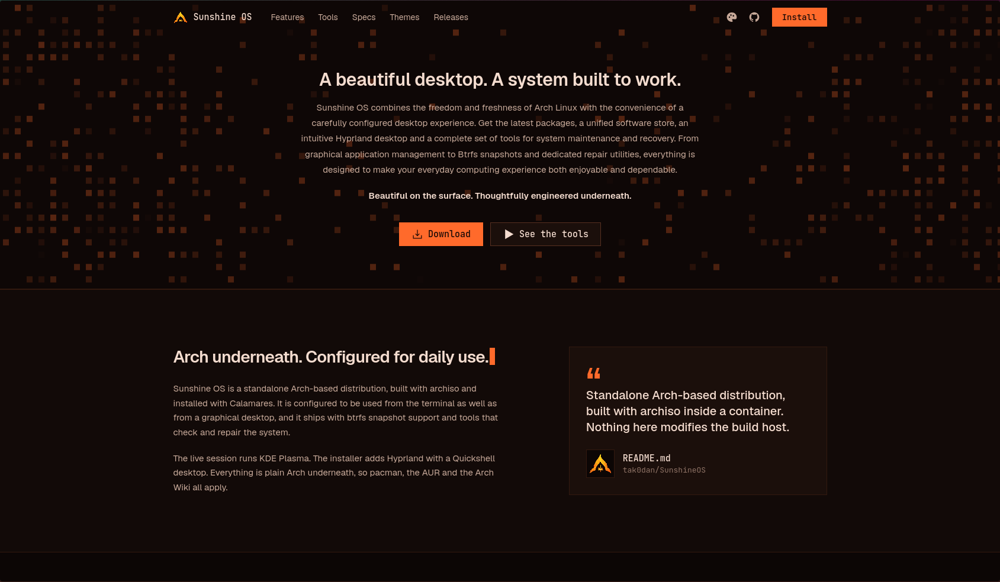
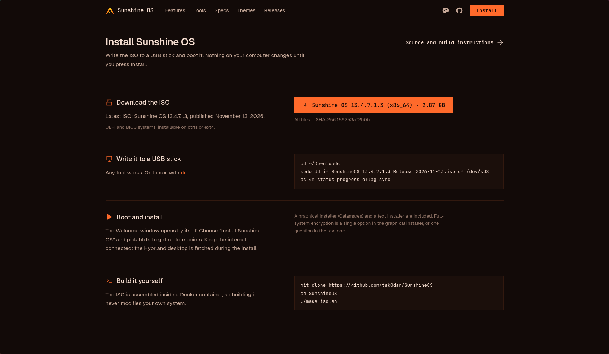
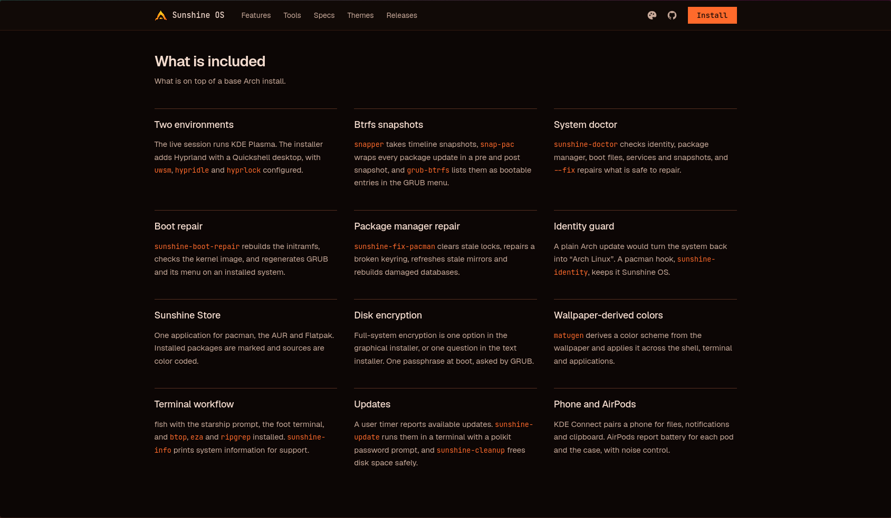
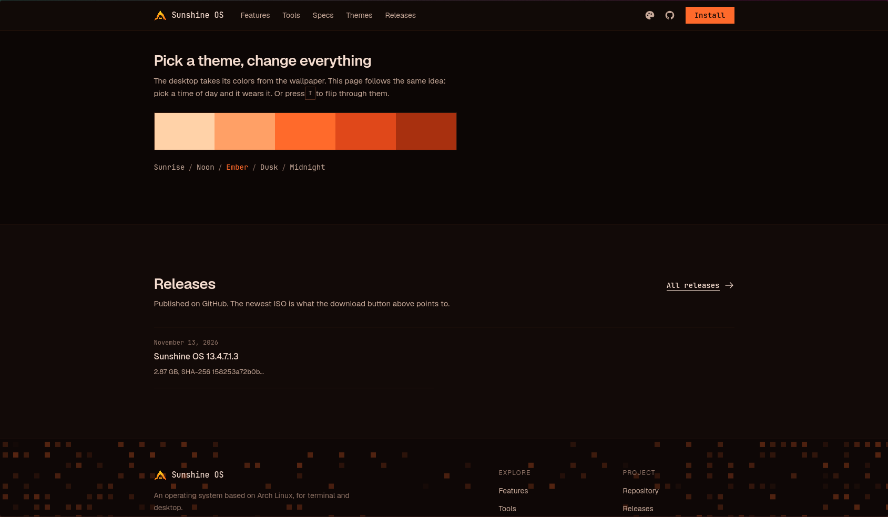
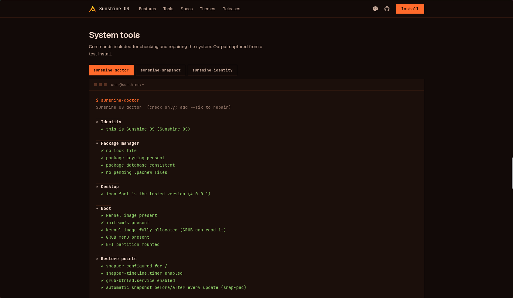
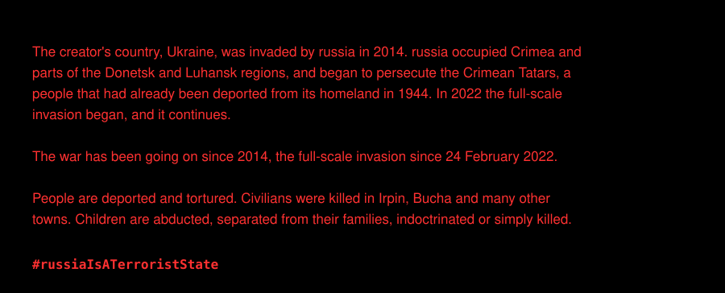

🌐 **[tak0dan.github.io/sunshineos-site](https://tak0dan.github.io/sunshineos-site/)** &nbsp;·&nbsp; English &nbsp;·&nbsp; [Українська](README.uk.md)

<div align="center">


# Sunshine OS

**A beautiful desktop. A system built to work.**

*Beautiful on the surface. Thoughtfully engineered underneath.*

<a href="https://tak0dan.github.io/sunshineos-site/?download=1#install"></a>&nbsp;&nbsp;<a href="https://tak0dan.github.io/sunshineos-site/"></a>

<sub>The download button asks the website to start the download: the file is saved by your browser and you stay on the page.</sub>

<br>


[](https://github.com/tak0dan/SunshineOS/releases/latest)


</div>



<p align="center">
<a href="#what-it-is">What it is</a> ·
<a href="#install">Install</a> ·
<a href="#whats-inside">What's inside</a> ·
<a href="#how-the-installer-works">Installer</a> ·
<a href="#the-sunshine-tools">Tools</a> ·
<a href="#build-it-yourself">Build</a> ·
<a href="#publishing">Publishing</a> ·
<a href="#repository-layout">Layout</a> ·
<a href="#stay-with-ukraine">Ukraine</a>
</p>

---

## What it is

Sunshine OS combines the freedom and freshness of Arch Linux with the convenience of a carefully configured desktop experience. You get the latest packages, a unified software store, an intuitive Hyprland desktop and a complete set of tools for system maintenance and recovery. From graphical application management to Btrfs snapshots and dedicated repair utilities, everything is designed to make everyday computing both enjoyable and dependable.

It is a **standalone Arch-based distribution**, not a respin of someone else's ISO: the live image is an [archiso](https://wiki.archlinux.org/title/Archiso) profile kept in this repository, assembled inside a container so that building never touches the build host, and installed with [Calamares](https://calamares.io/). Underneath it is plain Arch, so `pacman`, the AUR and the Arch Wiki all apply.

> **Beautiful on the surface. Thoughtfully engineered underneath.**



## Install

Write the ISO to a USB stick and boot it. Nothing on your computer changes until you press **Install**.

1. **Download the ISO** with the button above, or from the [releases page](https://github.com/tak0dan/SunshineOS/releases/latest). The file is named `SunshineOS_<version>_Release_<date>.iso` (about 2.9 GB).
2. **Verify it** (optional, recommended): compare the SHA-256 shown on the website, or from the release's `.sha256` file.
3. **Write it to a USB stick.** Any tool works. On Linux, with `dd`:
   ```sh
   cd ~/Downloads
   sudo dd if=SunshineOS_<version>_Release_<date>.iso of=/dev/sdX bs=4M status=progress oflag=sync
   ```
4. **Boot it** (UEFI or legacy BIOS). The live session starts in KDE Plasma and the **Welcome** window opens by itself.
5. **Choose "Install Sunshine OS"**, pick **btrfs** to get restore points, and optionally tick full-system encryption. Keep the network connected: the Hyprland desktop is installed as a separate step.



| | |
| --- | --- |
| Boot modes | UEFI (GRUB) and legacy BIOS (syslinux) |
| Filesystems | btrfs (with snapshots) or ext4 |
| Encryption | LUKS, one passphrase prompt, asked by GRUB |
| Installers | Calamares (graphical) and a text installer |

## What's inside



### At a glance

| Layer | What Sunshine OS ships |
| --- | --- |
| Base | Arch Linux, rolling release; official repositories, AUR and Flathub on top |
| Kernel | Arch `linux`, `linux-firmware`, `sof-firmware`, AMD and Intel microcode |
| Init | systemd |
| Boot | GRUB on UEFI and BIOS; live medium through GRUB (UEFI) or syslinux (BIOS) |
| Filesystems | btrfs with `snapper`, `snap-pac`, `grub-btrfs`, `btrfs-assistant`; or ext4 |
| Encryption | `cryptsetup` / LUKS; the key file is put into the initramfs so GRUB asks only once |
| Desktop | KDE Plasma in the live session; Hyprland + Quickshell (`uwsm`, `hypridle`, `hyprlock`) on the installed system; SDDM |
| Graphics | Wayland, Xwayland, Mesa |
| Audio | PipeWire (ALSA, PulseAudio and JACK compatible), WirePlumber |
| Network | NetworkManager, iwd, BlueZ, `ufw` |
| Power and memory | `power-profiles-daemon`, `zram-generator` |
| Shell | fish with the starship prompt, `foot` terminal, zsh available; `btop`, `eza`, `ripgrep` |
| Packages | `pacman`, `yay`, `paru`, Flatpak, and the Sunshine Store as one front end |
| Theming | `matugen` derives a colour scheme from the wallpaper and applies it to shell, terminal and applications |
| Extras | KDE Connect, AirPods battery and noise control (`librepods`), Sunshine pet and toolbox |

### Numbers

| | |
| --- | --- |
| Packages in the live image | 271 (`profile/packages.x86_64`) |
| Packages in the Hyprland payload | 115 (`hyprland/packages.txt`), shipped as an offline repository |
| Sunshine commands and helpers | 29 scripts under `profile/airootfs/usr/local/bin` |
| Locally built packages | 6 `PKGBUILD`s in `pkgs/`, 2 AUR recipes in `aur/` |
| Image | SquashFS, `xz` with 1 MiB blocks |

### The look

A warm, dark palette by default: gold on deep indigo, five themes (Sunrise, Noon, Ember, Dusk, Midnight) shared by the desktop and the website.



## How the installer works

The installer is Calamares with Sunshine's own modules. `sunshine-install` copies the live system to disk offline; the extra work is done by `shellprocess` steps defined in `profile/airootfs/etc/calamares/`.

```mermaid
flowchart LR
  A[welcome · locale · keyboard] --> B[partition]
  B --> C[users · summary]
  C --> D[mount · unpackfs]
  D --> E[machineid · fstab · luksbootkeyfile]
  E --> F[shellprocess@cleanup]
  F --> G[shellprocess@hyprland]
  G --> H[users · shellprocess@usershell]
  H --> I[shellprocess@crypt · shellprocess@snapshots]
  I --> J[networkcfg · hwclock · services-systemd]
  J --> K[initcpio · grubcfg · bootloader]
  K --> L[umount · finished]
```

| Step | What it does |
| --- | --- |
| `shellprocess@cleanup` | `sunshine-post-install` strips the live-session settings from the target system (runs in the chroot, before the user is created) |
| `shellprocess@hyprland` | `sunshine-hyprland-install` runs from the live system (not in the chroot): installs the Hyprland payload — dotfiles, offline package repository and Python venv — into the target |
| `shellprocess@usershell` | `sunshine-set-shell` gives the new user fish as the login shell |
| `shellprocess@crypt` | `sunshine-crypt-setup` puts Calamares' `/crypto_keyfile.bin` into the initramfs so the passphrase is asked once, by GRUB |
| `shellprocess@snapshots` | `sunshine-snapshots-setup` creates the snapper config for `/`, the timeline and cleanup timers, and a first snapshot |

## The Sunshine tools



| Command | Purpose |
| --- | --- |
| `sunshine-doctor` | Health check of identity, package manager, desktop, boot files, services and restore points. `--fix` repairs what is safe to repair and never removes your packages or files; `--quiet` prints only problems |
| `sunshine-snapshot` | Restore points (btrfs snapshots) in plain words: list, create, delete |
| `sunshine-boot-repair` | Rebuilds the initramfs, checks the kernel image, regenerates GRUB and its menu on an installed system |
| `sunshine-fix-pacman` | Clears stale locks, repairs a broken keyring, refreshes stale mirrors, rebuilds damaged databases |
| `sunshine-cleanup` | Frees disk space: old package files, unused packages (asks first), old logs, old restore points |
| `sunshine-update` | GUI entry point: opens a terminal that runs `sunshine-update-run` under a polkit prompt |
| `sunshine-update-notifier` | User timer that tells you when updates are available |
| `sunshine-identity` | Keeps `os-release`, `lsb-release`, `issue` and `motd` as Sunshine OS; a pacman hook runs it after every update of `filesystem` |
| `sunshine-info` | System information to paste into a support request |
| `sunshine-prompt` | Switch the terminal prompt style (`tokyo` or `pastel`) |
| `sunshine-term`, `sunshine-session` | Terminal with the Sunshine start-up animation, then fastfetch, then your shell |
| `sunshine-session-notice` | If Hyprland cannot start (for example inside VirtualBox), Plasma starts instead and tells you why |

### Restore points

`snapper` takes timeline snapshots, `snap-pac` wraps every package update in a *pre* and *post* snapshot, and `grub-btrfs` lists them as bootable entries in the GRUB menu. Something broke? Reboot, choose "Sunshine OS snapshots" in the boot menu, then restore from Btrfs Assistant.

### Identity guard

A plain Arch update of the `filesystem` package would turn the system back into "Arch Linux". The `sunshine-identity` pacman hook puts the Sunshine OS identity back, so `fastfetch`, `os-release` and the login screen stay correct.

### Sunshine Store

One application for pacman, the AUR and Flatpak. Installed packages are marked and sources are colour coded. Source: [tak0dan/sunshine-store](https://github.com/tak0dan/sunshine-store).

## Build it yourself

Needs: Docker (your user in the `docker` group), `git`, `rsync`, about 25 GB of free disk and a network connection. Nothing is installed on or changed in the host.

```sh
git clone https://github.com/tak0dan/SunshineOS
cd SunshineOS
./make-iso.sh          # clean checkout -> ISO in out/ (resumes where it stopped if re-run)
./make-iso.sh --clean  # rebuild image, AUR packages and the Hyprland payload from scratch
```

`make-iso.sh` runs these steps, each of which can also be run on its own:

| step | script | result |
|------|--------|--------|
| 1. builder image | `docker build -t sunshineos-builder .` | Arch container with archiso |
| 2. AUR packages | `build-aur.sh` (list from `tools/aur-list.sh`) | local pacman repo in `repo/` |
| 3. Hyprland payload | `tools/import-end4.sh`, `tools/build-venv.sh` | dotfiles, offline package repo and Python venv under `profile/airootfs/usr/share/sunshine/hyprland/` |
| 4. the ISO | `build.sh` | `out/*.iso` |

Some packages in `profile/packages.x86_64` and `hyprland/packages.txt` are not in the official repos. `tools/aur-list.sh` works out which, and `build-aur.sh` builds them from the AUR (or from `pkgs/<name>/PKGBUILD` when there is a local one). Packages and downloads are cached in `cache/` (override with `SUNSHINE_CACHE`); logs go to `logs/`. The scripts hand all output back to your own user, so no `sudo` is needed.

If an AUR dependency disappears upstream, add a replacement to `DEAD_DEP` at the top of `make-iso.sh` (or fix the `PKGBUILD` in `pkgs/`).

### Testing before the slow build

The release ISO takes a long time because of the `xz` compression. Most problems show up without it:

```sh
FAST=1 ./build.sh     # test image, light compression, written to out/fast/
test/smoke.sh         # boots it headless in QEMU with no network (about 3 minutes)
```

`test/smoke.sh` checks that the system boots and settles offline, has no failed units, that package files kept their permissions, that D-Bus, NetworkManager and the display manager run, and that the desktop session starts (screenshot in `test/tmp/smoke/`). Run it before every release build. The other scripts in `test/` boot the ISO in QEMU with UEFI or BIOS, attach throwaway disks, and drive the installer.

## Publishing

The ISO is stored on GitHub Releases in parts (GitHub refuses files of 2 GiB or more) and a Cloudflare Worker serves the newest release as one file, so the website's download button is an ordinary link.

```sh
tools/release-github.sh     # split out/*.iso into parts and create the GitHub Release (DRY=1 to preview)
SITE_DIR=<clone of the site repo> DOWNLOAD_URL=<Worker URL> JSON_ONLY=1 tools/release-github.sh   # write the release into the site's release.json
```

- `worker/iso-download.js` is the Worker's code (deploy it in the Cloudflare dashboard; it reads the site's `release.json`).
- The published name is `SunshineOS_<D>.<M>.<months>.<big>.<small>_<Release|Beta|Testing>_<date>.iso`: `<D>.<M>` and `<months>` come from a numbering anchor date kept in a local, git-ignored `ANCHOR` file (`<D>.<M>` is its day and month, `<months>` the whole months from it to the release date); `<big>.<small>` are the generation counters in the `VERSION` file; the channel is `Release` unless `SUNSHINE_CHANNEL=Beta|Testing`. Only `Release` files are served by the download button.
- To join the parts by hand: `cat SunshineOS_*.iso.part* > SunshineOS.iso`, then `sha256sum -c` against the `.sha256` file.
- The website reads `release.json`, so the version, file name, architecture and size on its button always match the newest release.

## Repository layout

| Path | Purpose |
| --- | --- |
| `profile/` | The archiso profile: `packages.x86_64`, `profiledef.sh`, `pacman.conf`, boot configs (`grub/`, `syslinux/`, `efiboot/`) and `airootfs/` (the files of the live system) |
| `profile/airootfs/usr/local/bin/` | The Sunshine commands and installer steps |
| `profile/airootfs/etc/calamares/` | Installer configuration, modules and branding |
| `hyprland/` | Package list of the Hyprland payload |
| `overlay/` | Files laid over the system: Quickshell config, skel, fastfetch logo |
| `pkgs/`, `aur/` | `PKGBUILD`s of packages that are not in the official repositories |
| `branding/` | Logos, icons, wallpapers, GRUB theme sources |
| `build.sh`, `make-iso.sh`, `build-aur.sh`, `Dockerfile` | The container build |
| `tools/` | Import, art generation, venv and release scripts |
| `test/` | QEMU boot, install and smoke tests with throwaway disks |
| `worker/` | Cloudflare Worker that serves the ISO as one file |

The website lives in [tak0dan/sunshineos-site](https://github.com/tak0dan/sunshineos-site). The Hyprland configuration comes from [Sunshine_end4_Dots](https://github.com/tak0dan/Sunshine_end4_Dots), based on [end-4's dots-hyprland](https://github.com/end-4/dots-hyprland).

---

## Stay with Ukraine

[](https://unitedhelpukraine.org/how-you-can-help/)



[Bucha](https://en.wikipedia.org/wiki/Bucha_massacre) · [Irpin](https://en.wikipedia.org/wiki/Battle_of_Irpin) · [Crimea](https://en.wikipedia.org/wiki/Annexation_of_Crimea_by_the_Russian_Federation) · [Donetsk and Luhansk](https://en.wikipedia.org/wiki/War_in_Donbas) · [Crimean Tatars](https://en.wikipedia.org/wiki/Deportation_of_the_Crimean_Tatars) · [Abducted children](https://en.wikipedia.org/wiki/Deportation_of_Ukrainian_children_to_Russia) · [War crimes](https://en.wikipedia.org/wiki/Russian_war_crimes) · [The full-scale invasion](https://en.wikipedia.org/wiki/Russian_invasion_of_Ukraine)

**[How you can help →](https://unitedhelpukraine.org/how-you-can-help/)**

<p align="center"><b>#StayWithUkraine</b> &nbsp;·&nbsp; <b>#russiaIsATerroristState</b></p>
