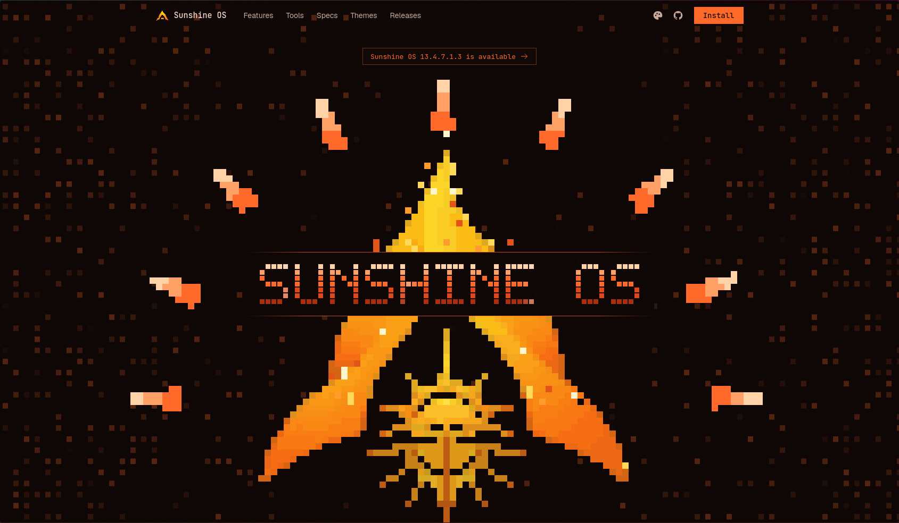
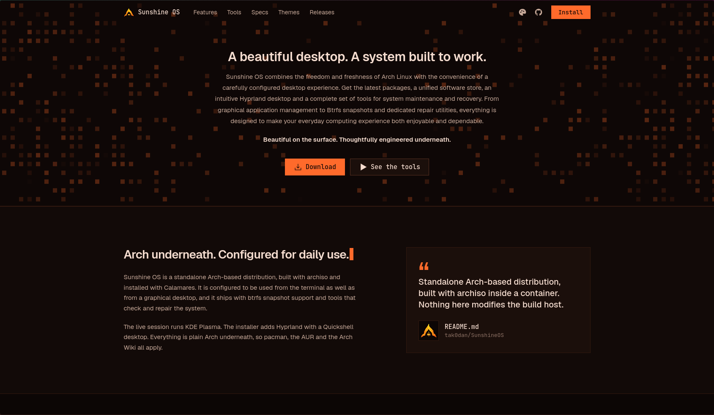
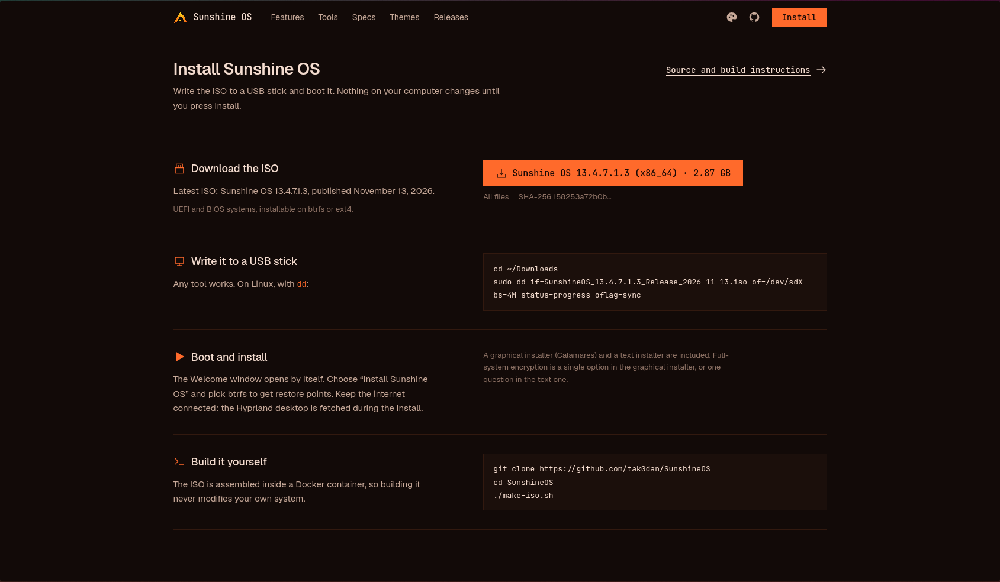
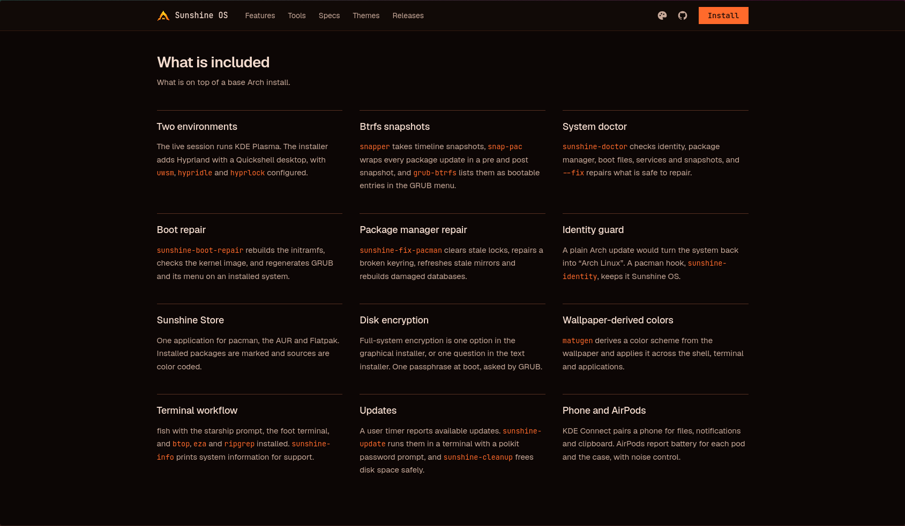
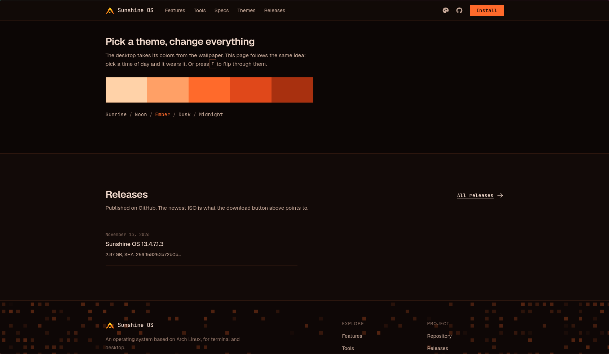
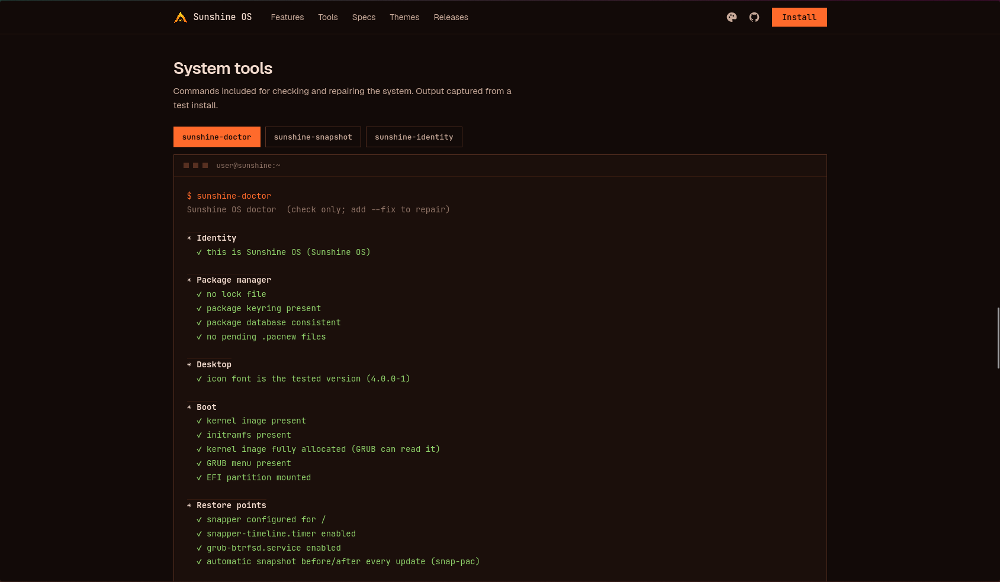
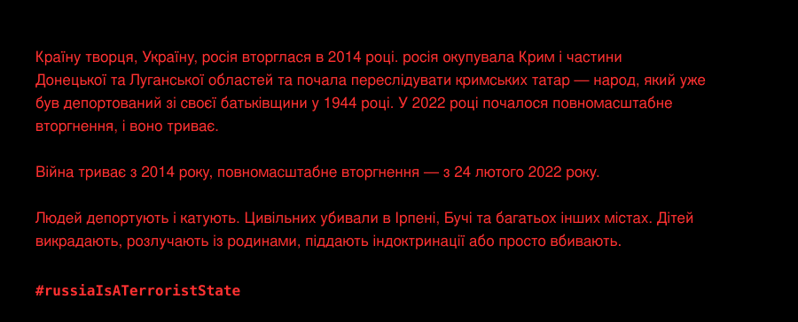

🌐 **[tak0dan.github.io/sunshineos-site/uk](https://tak0dan.github.io/sunshineos-site/uk/)** &nbsp;·&nbsp; [English](README.md) &nbsp;·&nbsp; Українська

<div align="center">


# Sunshine OS

**Красиве середовище. Система, створена для роботи.**

*Красива назовні. Продумана всередині.*

<a href="https://tak0dan.github.io/sunshineos-site/uk/?download=1#install"></a>&nbsp;&nbsp;<a href="https://tak0dan.github.io/sunshineos-site/uk/"></a>

<sub>Кнопка завантаження просить сайт розпочати завантаження: файл збереже ваш браузер, а ви залишитеся на сторінці.</sub>

<br>


[](https://github.com/tak0dan/SunshineOS/releases/latest)


</div>



<p align="center">
<a href="#що-це">Що це</a> ·
<a href="#встановлення">Встановлення</a> ·
<a href="#що-всередині">Що всередині</a> ·
<a href="#як-працює-інсталятор">Інсталятор</a> ·
<a href="#інструменти-sunshine">Інструменти</a> ·
<a href="#зберіть-самі">Збірка</a> ·
<a href="#публікація">Публікація</a> ·
<a href="#структура-репозиторію">Структура</a> ·
<a href="#stay-with-ukraine-залишайтеся-з-україною">Україна</a>
</p>

---

## Що це

Sunshine OS поєднує свободу й свіжість Arch Linux із зручністю ретельно налаштованого середовища. Найновіші пакети, єдиний магазин програм, інтуїтивне середовище Hyprland і повний набір засобів для обслуговування та відновлення системи. Від графічного керування програмами до знімків Btrfs і спеціальних утиліт ремонту — усе створене для того, щоб щоденна робота за комп’ютером була приємною та надійною.

Це **самостійний дистрибутив на основі Arch**, а не перезбірка чужого ISO: живий образ — це профіль [archiso](https://wiki.archlinux.org/title/Archiso) у цьому репозиторії, який збирається всередині контейнера, тож збірка ніколи не зачіпає вашу систему, а встановлюється він через [Calamares](https://calamares.io/). Усередині — звичайний Arch, тож `pacman`, AUR та Arch Wiki повністю застосовні.

> **Красива назовні. Продумана всередині.**



## Встановлення

Запишіть ISO на флешку й завантажтеся з неї. Нічого на вашому комп’ютері не зміниться, доки ви не натиснете **Install**.

1. **Завантажте ISO** кнопкою вище або зі [сторінки випусків](https://github.com/tak0dan/SunshineOS/releases/latest). Файл називається `SunshineOS_<версія>_Release_<дата>.iso` (близько 2,9 ГБ).
2. **Перевірте його** (необов’язково, але бажано): порівняйте SHA-256 на сайті або з файлом `.sha256` випуску.
3. **Запишіть на флешку.** Підійде будь-яка програма. У Linux — за допомогою `dd`:
   ```sh
   cd ~/Downloads
   sudo dd if=SunshineOS_<версія>_Release_<дата>.iso of=/dev/sdX bs=4M status=progress oflag=sync
   ```
4. **Завантажтеся з неї** (UEFI або застарілий BIOS). Живий сеанс запускається в KDE Plasma, і саме відкривається вікно **Welcome**.
5. **Оберіть «Install Sunshine OS»**, виберіть **btrfs**, щоб мати точки відновлення, і за бажання позначте шифрування всієї системи. Не вимикайте мережу: середовище Hyprland встановлюється окремим кроком.



| | |
| --- | --- |
| Режими завантаження | UEFI (GRUB) і застарілий BIOS (syslinux) |
| Файлові системи | btrfs (зі знімками) або ext4 |
| Шифрування | LUKS, одна парольна фраза, яку запитує GRUB |
| Інсталятори | Calamares (графічний) і текстовий |

## Що всередині



### Коротко

| Рівень | Що постачається в Sunshine OS |
| --- | --- |
| Основа | Arch Linux, неперервні випуски; офіційні репозиторії, а поверх — AUR і Flathub |
| Ядро | Arch `linux`, `linux-firmware`, `sof-firmware`, мікрокод AMD та Intel |
| Ініціалізація | systemd |
| Завантаження | GRUB на UEFI та BIOS; живий носій — через GRUB (UEFI) або syslinux (BIOS) |
| Файлові системи | btrfs із `snapper`, `snap-pac`, `grub-btrfs`, `btrfs-assistant`; або ext4 |
| Шифрування | `cryptsetup` / LUKS; файл ключа кладеться в initramfs, тож GRUB питає лише один раз |
| Середовище | KDE Plasma в живому сеансі; Hyprland + Quickshell (`uwsm`, `hypridle`, `hyprlock`) на встановленій системі; SDDM |
| Графіка | Wayland, Xwayland, Mesa |
| Звук | PipeWire (сумісний з ALSA, PulseAudio та JACK), WirePlumber |
| Мережа | NetworkManager, iwd, BlueZ, `ufw` |
| Живлення та пам’ять | `power-profiles-daemon`, `zram-generator` |
| Оболонка | fish із запрошенням starship, термінал `foot`, доступний zsh; `btop`, `eza`, `ripgrep` |
| Пакети | `pacman`, `yay`, `paru`, Flatpak, а Sunshine Store — єдиний інтерфейс |
| Теми | `matugen` виводить колірну схему зі шпалер і застосовує її в оболонці, терміналі та програмах |
| Додатково | KDE Connect, заряд і шумозаглушення AirPods (`librepods`), Sunshine pet і toolbox |

### Цифри

| | |
| --- | --- |
| Пакетів у живому образі | 271 (`profile/packages.x86_64`) |
| Пакетів у корисному навантаженні Hyprland | 115 (`hyprland/packages.txt`), постачаються як офлайн-репозиторій |
| Команд і допоміжних скриптів Sunshine | 29 скриптів у `profile/airootfs/usr/local/bin` |
| Локально зібрані пакети | 6 `PKGBUILD` у `pkgs/`, 2 рецепти AUR у `aur/` |
| Образ | SquashFS, `xz` із блоками по 1 МіБ |

### Вигляд

Тепла темна палітра за замовчуванням: золото на глибокому індиго, п’ять тем (Світанок, Полудень, Жар, Присмерк, Північ), спільних для середовища та сайту.



## Як працює інсталятор

Інсталятор — це Calamares із власними модулями Sunshine. `sunshine-install` копіює живу систему на диск без підключення до мережі; решту роблять кроки `shellprocess`, описані в `profile/airootfs/etc/calamares/`.

```mermaid
flowchart LR
  A[welcome · locale · keyboard] --> B[partition]
  B --> C[users · summary]
  C --> D[mount · unpackfs]
  D --> E[machineid · fstab · luksbootkeyfile]
  E --> F[shellprocess@cleanup]
  F --> G[shellprocess@hyprland]
  G --> H[users · shellprocess@usershell]
  H --> I[shellprocess@crypt · shellprocess@snapshots]
  I --> J[networkcfg · hwclock · services-systemd]
  J --> K[initcpio · grubcfg · bootloader]
  K --> L[umount · finished]
```

| Крок | Що робить |
| --- | --- |
| `shellprocess@cleanup` | `sunshine-post-install` прибирає налаштування живого сеансу з цільової системи (виконується в chroot, до створення користувача) |
| `shellprocess@hyprland` | `sunshine-hyprland-install` працює із живої системи (не в chroot): встановлює в ціль навантаження Hyprland — dotfiles, офлайн-репозиторій пакетів і Python venv |
| `shellprocess@usershell` | `sunshine-set-shell` робить fish оболонкою входу нового користувача |
| `shellprocess@crypt` | `sunshine-crypt-setup` кладе `/crypto_keyfile.bin` від Calamares в initramfs, щоб парольну фразу запитував лише GRUB, один раз |
| `shellprocess@snapshots` | `sunshine-snapshots-setup` створює конфігурацію snapper для `/`, таймери знімків і очищення та перший знімок |

## Інструменти Sunshine



| Команда | Призначення |
| --- | --- |
| `sunshine-doctor` | Перевірка ідентичності, менеджера пакетів, середовища, файлів завантаження, служб і точок відновлення. `--fix` виправляє те, що безпечно виправляти, і ніколи не видаляє ваших пакетів чи файлів; `--quiet` показує лише проблеми |
| `sunshine-snapshot` | Точки відновлення (знімки btrfs) простими словами: перегляд, створення, видалення |
| `sunshine-boot-repair` | Перебудовує initramfs, перевіряє образ ядра, відновлює GRUB і його меню на встановленій системі |
| `sunshine-fix-pacman` | Прибирає застарілі блокування, лагодить в’язку ключів, оновлює застарілі дзеркала, відбудовує пошкоджені бази |
| `sunshine-cleanup` | Звільняє місце: старі файли пакетів, невикористані пакети (спитає), старі журнали, старі точки відновлення |
| `sunshine-update` | Графічна точка входу: відкриває термінал, що запускає `sunshine-update-run` із запитом пароля polkit |
| `sunshine-update-notifier` | Таймер користувача, що повідомляє про доступні оновлення |
| `sunshine-identity` | Залишає `os-release`, `lsb-release`, `issue` і `motd` як Sunshine OS; хук pacman запускає його після кожного оновлення `filesystem` |
| `sunshine-info` | Відомості про систему, які можна вставити у звернення по допомогу |
| `sunshine-prompt` | Перемикає стиль запрошення терміналу (`tokyo` або `pastel`) |
| `sunshine-term`, `sunshine-session` | Термінал зі стартовою анімацією Sunshine, потім fastfetch, потім ваша оболонка |
| `sunshine-session-notice` | Якщо Hyprland не може запуститися (наприклад, у VirtualBox), замість нього стартує Plasma, і вас про це повідомляють |

### Точки відновлення

`snapper` робить регулярні знімки, `snap-pac` обрамляє кожне оновлення пакетів знімками *до* і *після*, а `grub-btrfs` показує їх як завантажувані пункти в меню GRUB. Щось зламалося? Перезавантажтеся, оберіть «Sunshine OS snapshots» у меню завантаження, а потім відновіть через Btrfs Assistant.

### Захист ідентичності

Звичайне оновлення пакета `filesystem` в Arch повернуло б системі назву «Arch Linux». Хук pacman `sunshine-identity` повертає ідентичність Sunshine OS, тож `fastfetch`, `os-release` та екран входу залишаються правильними.

### Sunshine Store

Одна програма для pacman, AUR і Flatpak. Встановлені пакети позначені, а джерела розрізняються кольором. Код: [tak0dan/sunshine-store](https://github.com/tak0dan/sunshine-store).

## Зберіть самі

Потрібні: Docker (ваш користувач у групі `docker`), `git`, `rsync`, близько 25 ГБ вільного місця на диску та мережа. Нічого не встановлюється на вашу систему й не змінюється в ній.

```sh
git clone https://github.com/tak0dan/SunshineOS
cd SunshineOS
./make-iso.sh          # чисте дерево -> ISO в out/ (продовжує з місця зупинки при повторному запуску)
./make-iso.sh --clean  # відбудувати образ, пакети AUR і навантаження Hyprland з нуля
```

`make-iso.sh` виконує такі кроки, кожен із яких можна запустити й окремо:

| крок | скрипт | результат |
|------|--------|-----------|
| 1. образ збирача | `docker build -t sunshineos-builder .` | контейнер Arch з archiso |
| 2. пакети AUR | `build-aur.sh` (список із `tools/aur-list.sh`) | локальний репозиторій pacman у `repo/` |
| 3. навантаження Hyprland | `tools/import-end4.sh`, `tools/build-venv.sh` | dotfiles, офлайн-репозиторій пакетів і Python venv у `profile/airootfs/usr/share/sunshine/hyprland/` |
| 4. сам ISO | `build.sh` | `out/*.iso` |

Деяких пакетів із `profile/packages.x86_64` та `hyprland/packages.txt` немає в офіційних репозиторіях. `tools/aur-list.sh` визначає, яких саме, а `build-aur.sh` збирає їх з AUR (або з `pkgs/<name>/PKGBUILD`, якщо є локальний). Пакети й завантаження кешуються в `cache/` (змінюється через `SUNSHINE_CACHE`); журнали — в `logs/`. Скрипти повертають усі результати вашому користувачу, тож `sudo` не потрібен.

Якщо залежність AUR зникне, додайте заміну до `DEAD_DEP` на початку `make-iso.sh` (або виправте `PKGBUILD` у `pkgs/`).

### Перевірка перед повільною збіркою

Випуск ISO збирається довго через стиснення `xz`. Більшість проблем видно і без нього:

```sh
FAST=1 ./build.sh     # тестовий образ, легке стиснення, пишеться в out/fast/
test/smoke.sh         # запускає його без графіки в QEMU без підключення до мережі (близько 3 хвилин)
```

`test/smoke.sh` перевіряє, що система завантажується й заспокоюється офлайн, не має збійних служб, що файли пакетів зберегли права доступу, що працюють D-Bus, NetworkManager і менеджер входу, та що запускається сеанс середовища (знімок екрана в `test/tmp/smoke/`). Запускайте його перед кожною збіркою випуску. Інші скрипти в `test/` завантажують ISO в QEMU з UEFI чи BIOS, під’єднують одноразові диски й керують інсталятором.

## Публікація

ISO зберігається в GitHub Releases частинами (GitHub не приймає файли від 2 ГіБ), а Cloudflare Worker віддає найновіший випуск одним файлом, тож кнопка завантаження на сайті — звичайне посилання.

```sh
tools/release-github.sh     # розрізає out/*.iso на частини та створює GitHub Release (DRY=1 — лише показати)
SITE_DIR=<клон репозиторію сайту> DOWNLOAD_URL=<адреса Worker> JSON_ONLY=1 tools/release-github.sh   # записує випуск у release.json сайту
```

- `worker/iso-download.js` — код Worker (розгортається в панелі Cloudflare; читає `release.json` сайту).
- Опублікована назва: `SunshineOS_<D>.<M>.<місяці>.<велике>.<мале>_<Release|Beta|Testing>_<дата>.iso`: `<D>.<M>` і `<місяці>` походять від опорної дати нумерації в локальному файлі `ANCHOR`, якого немає в git (`<D>.<M>` — її день і місяць, `<місяці>` — повні місяці від неї до дати випуску); `<велике>.<мале>` — лічильники поколінь у файлі `VERSION`; канал — `Release`, якщо не задано `SUNSHINE_CHANNEL=Beta|Testing`. Кнопка завантаження віддає лише файли `Release`.
- Щоб з’єднати частини вручну: `cat SunshineOS_*.iso.part* > SunshineOS.iso`, потім `sha256sum -c` зі файлом `.sha256`.
- Сайт читає `release.json`, тож версія, назва файлу, архітектура й розмір на його кнопці завжди відповідають найновішому випуску.

## Структура репозиторію

| Шлях | Призначення |
| --- | --- |
| `profile/` | Профіль archiso: `packages.x86_64`, `profiledef.sh`, `pacman.conf`, конфігурації завантаження (`grub/`, `syslinux/`, `efiboot/`) та `airootfs/` (файли живої системи) |
| `profile/airootfs/usr/local/bin/` | Команди Sunshine і кроки інсталятора |
| `profile/airootfs/etc/calamares/` | Налаштування інсталятора, модулі та брендинг |
| `hyprland/` | Список пакетів навантаження Hyprland |
| `overlay/` | Файли, накладені на систему: конфігурація Quickshell, skel, логотип fastfetch |
| `pkgs/`, `aur/` | `PKGBUILD` пакетів, яких немає в офіційних репозиторіях |
| `branding/` | Логотипи, значки, шпалери, джерела теми GRUB |
| `build.sh`, `make-iso.sh`, `build-aur.sh`, `Dockerfile` | Збірка в контейнері |
| `tools/` | Скрипти імпорту, генерації графіки, venv і випуску |
| `test/` | Тести завантаження, встановлення та smoke в QEMU з одноразовими дисками |
| `worker/` | Cloudflare Worker, що віддає ISO одним файлом |

Сайт — у [tak0dan/sunshineos-site](https://github.com/tak0dan/sunshineos-site). Конфігурація Hyprland походить із [Sunshine_end4_Dots](https://github.com/tak0dan/Sunshine_end4_Dots), створеного на основі [dots-hyprland від end-4](https://github.com/end-4/dots-hyprland).

---

## Stay with Ukraine — залишайтеся з Україною

[](https://unitedhelpukraine.org/how-you-can-help/)



[Буча](https://uk.wikipedia.org/wiki/Бучанська_різанина) · [Ірпінь](https://uk.wikipedia.org/wiki/Битва_за_Ірпінь) · [Крим](https://uk.wikipedia.org/wiki/Анексія_Криму_(2014)) · [Донецьк і Луганськ](https://uk.wikipedia.org/wiki/Війна_на_сході_України) · [Кримські татари](https://uk.wikipedia.org/wiki/Депортація_кримських_татар) · [Викрадені діти](https://uk.wikipedia.org/wiki/Викрадення_дітей_під_час_російського_вторгнення_в_Україну) · [Воєнні злочини](https://uk.wikipedia.org/wiki/Воєнні_злочини_Росії) · [Повномасштабне вторгнення](https://uk.wikipedia.org/wiki/Російське_вторгнення_в_Україну_(з_2022))

**[Як допомогти →](https://unitedhelpukraine.org/how-you-can-help/)**

<p align="center"><b>#StayWithUkraine</b> &nbsp;·&nbsp; <b>#russiaIsATerroristState</b></p>
